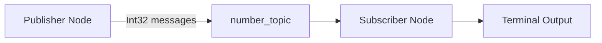

# ROS 2 Publisher and Subscriber

A beginner-friendly ROS 2 project demonstrating publisher-subscriber communication using Python (`rclpy`).

## Overview

This project implements two ROS 2 nodes:

- **Publisher Node:** Generates and publishes integer values every second.
- **Subscriber Node:** Subscribes to the published values and displays them in the terminal.

Both nodes communicate through a ROS 2 topic named `number_topic`, using the `Int32` message type.

## Project Architecture



## Technologies Used

- ROS 2
- Python 3
- rclpy
- std_msgs
- Ubuntu Linux

## Project Structure

```text
pub_sub_demo/
├── pub_sub_demo/
│   ├── __init__.py
│   ├── publisher.py
│   └── subscriber.py
├── resource/
│   └── pub_sub_demo
├── test/
├── package.xml
├── setup.py
├── setup.cfg
├── README.md
└── .gitignore
```

## How It Works

### 1. Publisher Node

The publisher:
- Creates a publisher using `rclpy`.
- Publishes messages of type `std_msgs/Int32`.
- Uses the topic `number_topic`.
- Publishes a new integer every 1 second.
- Increments the counter after each publication.

### 2. Subscriber Node

The subscriber:
- Creates a subscription to `number_topic`.
- Receives `Int32` messages.
- Uses a callback function to process incoming messages.
- Displays received values using the ROS 2 logger.

## Installation and Execution

### Prerequisites

- Ubuntu Linux
- ROS 2 installed and sourced
- Python 3
- colcon build tools

### Step 1: Clone the repository

```bash
cd ~/ros2_ws/src
git clone https://github.com/Pihukumari0821/ros2-publisher-subscriber.git
```

### Step 2: Build the package

```bash
cd ~/ros2_ws
source /opt/ros/<ros_distro>/setup.bash
colcon build --packages-select pub_sub_demo
```

Replace `<ros_distro>` with your installed ROS 2 distribution.

### Step 3: Source the workspace

```bash
source ~/ros2_ws/install/setup.bash
```

### Step 4: Run the publisher

Open Terminal 1:

```bash
source /opt/ros/<ros_distro>/setup.bash
source ~/ros2_ws/install/setup.bash
ros2 run pub_sub_demo publisher
```

### Step 5: Run the subscriber

Open Terminal 2:

```bash
source /opt/ros/<ros_distro>/setup.bash
source ~/ros2_ws/install/setup.bash
ros2 run pub_sub_demo subscriber
```

## Expected Output

**Publisher Terminal:**

```text
[INFO] Publishing: 0
[INFO] Publishing: 1
[INFO] Publishing: 2
[INFO] Publishing: 3
```

**Subscriber Terminal:**

```text
[INFO] Received: 0
[INFO] Received: 1
[INFO] Received: 2
[INFO] Received: 3
```

## Learning Outcomes

Through this project, I learned:

- ROS 2 node creation using Python.
- Publisher and subscriber communication.
- Working with ROS 2 topics.
- Using standard ROS 2 message types.
- Implementing timer callbacks.
- Building and running Python packages using colcon.

## Author

**Pihu Kumari**

GitHub: https://github.com/Pihukumari0821
